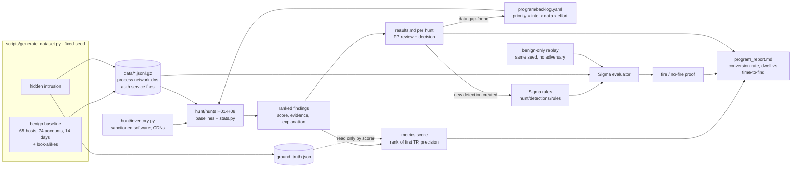

# Threat Hunting Program

A hypothesis-driven threat hunting program for a Tier 2 SOC: PEAK-framework hunts with baselines and statistics, run against a 14-day synthetic enterprise dataset, each producing a documented finding and, when it earns it, a new detection.

   

## Why this project exists

Detection rules only catch what someone already knew to write a rule for. Tier 2 is expected to go looking for what the rules miss, and to come back with something more useful than "I ran some queries." That takes a written hypothesis, a baseline of what normal looks like, statistics that separate an implant from the update agent that also checks in every hour, a false-positive review someone else can check, and a decision about whether the finding becomes a detection, stays a scheduled hunt, or exposes a logging gap. This repo runs that loop end to end: eight hunts against a fictional company's 14 days of telemetry with one intrusion hidden in it, scored against ground truth the hunts never see.

This is the *hunting* half of the portfolio. The rule packs (Splunk SPL, Sentinel KQL, Sigma mini-SIEM, ML beaconing/DGA) are in the sibling repos. Here the work is the method: hypotheses, baselines, ranked outliers, documented decisions, and the feedback loop into detection engineering.

## What it demonstrates

- **PEAK-framework hunts** (Prepare / Execute / Act with Knowledge): eight `hypothesis.md` files with hypothesis, ATT&CK technique, data sources, assumptions and scope written before execution, and the Execute/Act sections filled in from the actual results
- **Hunting statistics implemented from scratch** (`hunt/stats.py`, stdlib only, unit-tested): coefficient of variation, robust CV via median absolute deviation, classic and robust (MAD) z-scores with degenerate-case handling, Shannon entropy, linear-interpolation percentiles, fleet stacking and long-tail extraction
- **Beacon hunting that tolerates jitter** (H01): robust CV + jitter-band fraction + payload stability, plus a measured demonstration of why connection-count ranking fails (it puts the implant at #15 of 559 behind a chatty sync client)
- **Fleet stacking** for rare process lineage (H02) and rare persistence (H06); **per-entity baselines** for logon behaviour (H07); **per-host percentile baselines** for LOLBin use (H04) and egress volume (H08); **entropy/cardinality** for DNS tunneling (H05); **sliding-window distinct counts** for Kerberoasting (H03)
- **Explicit false-positive review** generated from the data for every hunt: update agent, NTP, APM telemetry, file sync, nightly backup, IT admin tools, a legacy RC4 service account, CDNs, a late-working user, a nightly scanner
- **Hunt-to-detection feedback loop**: six hunts graduated to Sigma rules, proven by a small built-in Sigma evaluator (including a value-count correlation) to fire on the intrusion and produce **zero** alerts on a benign-only replay of the same environment; one hunt closed as a documented baseline, one as a data gap
- **Production queries** for every hunt in both **KQL** (Sentinel / Defender XDR) and **SPL** (Splunk)
- **Program management**: a prioritised backlog (intel relevance x data availability x effort), conversion rate, data gaps, dwell time vs time-to-find (each hunt replayed on a daily cadence)
- **Ground-truth scoring**: recall, rank of first true positive and precision per hunt, with the hunts mechanically prevented from reading the answer key (a test asserts it)

## For hiring managers (30-second version)

| Tier 2 SOC requirement | Where it is proven |
|---|---|
| Proactive threat hunting beyond existing alerts | [`hunts/`](hunts/) - eight PEAK hunts, each with hypothesis, queries, results and a decision |
| Form and test hypotheses from threat intel and ATT&CK | `hypothesis.md` Prepare sections; hypothesis sources in [`program/backlog.yaml`](program/backlog.yaml) |
| Baseline normal behaviour and identify anomalies | [`hunt/stats.py`](hunt/stats.py); stacking in H02/H06, per-account baselines in H07, percentiles in H08 |
| Separate true positives from false positives | the false-positive review in every `results.md`, e.g. [H01](hunts/H01-c2-beaconing/results.md) |
| Write queries in the SIEM (KQL / SPL) | `query.kql` and `query.spl` in every hunt folder |
| Turn findings into detections; tune for low noise | [`hunt/detections/rules/`](hunt/detections/rules/) - 6 Sigma rules, 0 benign-baseline alerts |
| Determine scope and reconstruct the intrusion | the "Intrusion reconstructed" timeline in [`program/program_report.md`](program/program_report.md) |
| Identify logging and visibility gaps | data gaps in each `results.md`; H05 closed as a data gap; blocked backlog items |
| Report clearly to leads and stakeholders | [`program/program_report.md`](program/program_report.md), [`docs/methodology.md`](docs/methodology.md) |
| Measure and improve the process | `python -m hunt score`; conversion rate, dwell vs time-to-find |

## Framework mapping

| Hunt | Security+ SY0-701 | MITRE ATT&CK | NIST CSF 2.0 | NIST SP 800-61 |
|---|---|---|---|---|
| H01 C2 beaconing | 4.8 Threat hunting; 4.9 Network data sources; 2.4 Indicators (beaconing) | T1071.001, T1573 | DE.CM-01, DE.AE-02 | Detection & Analysis |
| H02 Rare process lineage | 4.8 Threat hunting; 2.4 Malware indicators; 4.9 Endpoint logs | T1204.002, T1059.003, T1218.011 | DE.CM-09, DE.AE-02 | Detection & Analysis |
| H03 Kerberoasting | 2.4 Password attacks; 4.6 Identity and access management | T1558.003 | DE.CM-03, DE.AE-02 | Detection & Analysis; Containment |
| H04 LOLBin abuse | 2.4 Indicators (living off the land); 4.9 Endpoint logs | T1105, T1218.010, T1218.005 | DE.CM-09 | Detection & Analysis |
| H05 DNS tunneling | 2.4 Network attack indicators; 4.5 DNS filtering; 4.9 Data sources | T1048.003, T1071.004 | DE.CM-01, ID.IM-02 (data gap) | Detection & Analysis |
| H06 Fleet-rare persistence | 4.8 Threat hunting; 4.1 Baselines | T1543.003, T1053.005, T1036.004 | DE.CM-09, DE.AE-02 | Detection & Analysis; Eradication |
| H07 Anomalous logons | 4.6 IAM (service accounts, least privilege); 2.4 Account compromise indicators | T1078.002, T1021.001 | DE.CM-03, PR.AA-05 | Detection & Analysis; Containment |
| H08 Staging and exfiltration | 2.4 Data exfiltration indicators; 4.4 DLP; 5.1 Data protection | T1074.001, T1560.001, T1567.002 | DE.CM-01, DE.AE-03 | Detection & Analysis |
| Program: backlog, metrics, gaps | 4.8 Incident response (lessons learned); 5.1 Reporting; 4.4 Alert tuning | - | GV.OV, ID.IM-01/02, DE.AE | Post-Incident Activity |

## Architecture



## Quickstart

```bash
git clone https://github.com/brooklynkid707-cmd/threat-hunting-program.git
cd threat-hunting-program
pip install -r requirements.txt      # pyyaml + pytest; add --break-system-packages on a system Python

make test                             # 90 tests, ~15s
make demo                             # list, run H01, run-all, score, detect, regenerate reports (~7s)
```

Individual commands:

```bash
python -m hunt list                   # the eight hunts, technique, decision
python -m hunt run H01 --top 10       # ranked findings with explanations
python -m hunt run H03 --json         # machine-readable findings
python -m hunt run-all --out output/  # one JSON per hunt
python -m hunt score                  # recall / rank of first TP / precision vs ground truth
python -m hunt detect                 # run the graduated Sigma rules
python -m hunt report                 # regenerate hunts/*/results.md, program report, examples/
make data                             # regenerate the dataset (byte-identical)
```

## Sample output

Per-hunt scoring against ground truth (from [`program/program_report.md`](program/program_report.md)):

| Hunt | Technique | Top-ranked entity | True positive? | Rank of first TP | Decision |
|---|---|---|---|---:|---|
| H01 | T1071.001 | `WKS-0042 -> cdn-sync-07.telemetry-edge.example` | yes | 1 | baseline documented, no detection |
| H02 | T1204.002 | `excel.exe -> cmd.exe -> rundll32.exe` | yes | 1 | new detection created |
| H03 | T1558.003 | `rbaxter` | yes | 1 | new detection created |
| H04 | T1105 | `WKS-0042 / certutil.exe` | yes | 1 | new detection created |
| H05 | T1048.003 | `dataxfil-svc.example` | yes | 1 | data gap found |
| H06 | T1543.003 | `WinSyncHelper` | yes | 1 | new detection created |
| H07 | T1078.002 | `svc-backup` | yes | 1 | new detection created |
| H08 | T1567.002 | `WKS-0042 / archive.7z` | yes | 1 | new detection created |

Program: 8 hunts, 8 true positives, 6 detections created (75% conversion), 1 data-gap closure, 0 benign-baseline alerts from any graduated rule. Mean dwell of the planted activity in the window was 220.0 h; a daily run of each hunt would have found it in 16.0 h on average.

H01 beaconing excerpt (from [`hunts/H01-c2-beaconing/results.md`](hunts/H01-c2-beaconing/results.md)): the implant against the benign beacon-like software.

```text
Top-ranked (host -> domain)                         score  verdict    conns  median   CV    robust CV  in-band  bytes CV
WKS-0042 -> cdn-sync-07.telemetry-edge.example       80.8  malicious   3037    301s  0.12       0.15     100%      0.03
WKS-0040 -> fonts.gstatic.example                     7.1  benign        20  74226s  0.73       0.41      53%      0.55
WKS-0043 -> time.ntp-pool.example                     4.8  benign       319   2056s  2.14       0.02      96%      0.02  (sanctioned, suppressed)

Sanctioned look-alikes (fleet medians)           hosts  conns  median   CV    robust CV  in-band  raw score  why excluded
updates.contoso-software.example (update agent)     60    183   3716s  1.61       0.40      58%       38.0  high CV / wide jitter; inventoried
time.ntp-pool.example (Windows Time)                60    320   2051s  2.14       0.02      96%       95.0  metronome-regular; inventoried
telemetry.vendor-apm.example (APM agent)             3   1342    899s  0.05       0.04     100%       93.7  metronome-regular; inventoried
sync.collab-suite.example (file sync)               14   4236     53s 18.17       1.03      21%        0.0  bursty, event-driven

Naive frequency ranking puts WKS-0005 -> sync.collab-suite.example first (4,365 connections);
the implant ranks #15 of 559 by count. Counting finds chatty software, not beacons.
```

Two things worth noticing. The update agent's hourly check-in with +/-50% jitter gives it a robust CV of 0.40, while the implant's 20% jitter stays at 0.15. NTP and the APM agent are *more* regular than the implant and are only excluded because they are in the software inventory. That dependency on a maintained allowlist is why H01 stayed a scheduled hunt instead of becoming a rule.

## Project layout

```text
threat-hunting-program/
├── hunt/                         Python package (python -m hunt)
│   ├── stats.py                  CV, robust CV/MAD, z-scores, entropy, percentiles, stacking (stdlib)
│   ├── data.py                   gzip JSONL loader, time-window views, benign-only replay
│   ├── inventory.py              sanctioned software / CDNs / admin hosts (auditable suppressions)
│   ├── hunts/h01..h08_*.py       one module per hunt: run() -> ranked Findings, fp_review()
│   ├── detections/               minimal Sigma evaluator (+ value-count correlation)
│   │   └── rules/*.yml           6 graduated Sigma rules
│   ├── metrics.py                ground-truth scoring, time-to-find replay, detection proof
│   ├── report.py                 results.md, program report, examples JSON
│   └── cli.py                    list | run | run-all | score | detect | report
├── hunts/H0N-<slug>/             hypothesis.md (PEAK), query.kql, query.spl, results.md (generated)
├── program/
│   ├── backlog.yaml              prioritised hunt backlog incl. blocked data-gap items
│   └── program_report.md         generated program metrics and intrusion timeline
├── docs/
│   ├── methodology.md            hypothesis sources, PEAK vs TaHiTI, baselining, bias, graduation
│   └── hunt-template.md          blank PEAK hunt template
├── scripts/generate_dataset.py   deterministic Northwind generator (fixed seed, --benign-only)
├── data/                         committed dataset (~3 MB gzip JSONL) + ground_truth.json
├── examples/                     findings.json, scores.json (committed demo output)
├── tests/                        90 pytest tests
├── output/                       ad-hoc run output (gitignored)
└── Makefile  requirements.txt  pytest.ini  LICENSE  .github/workflows/tests.yml
```

## Limitations and honest notes

- **All data is synthetic.** Northwind Logistics is fictional, and there are no real hosts, users or credentials. External addresses are RFC 5737 documentation ranges, internal ones RFC 1918, and every domain ends in `.example`. Attacker activity exists only as log text (command lines, ticket requests, connection records); nothing in the repo executes or is a usable tool.
- **The intrusion is planted by the same author who wrote the hunts.** A perfect 8/8 at rank 1 is what you get when the generator and the hunts share a mental model. The meaningful evidence is narrower: the hunts stay at zero malicious verdicts on a benign-only replay, the false-positive reviews show *why* each look-alike scored as it did, and H01 shows a measured failure of the naive approach. A real environment would be messier, and the first runs there would include real tuning.
- **The benign baseline is simplified.** 65 hosts and 74 accounts with designed look-alikes, not a production network's long tail of software. Real fleet stacking produces hundreds of rare-but-benign lineages, and real beacon hunting has to handle dozens of legitimate agents, which is why the inventory is a first-class component here.
- **The Sigma evaluator is a subset.** It supports field matching, the common modifiers, boolean conditions, `N of` / `all of` and a value-count correlation, not the full Sigma specification or backend conversion. The KQL and SPL queries are written for production schemas (`DeviceNetworkEvents`, `SecurityEvent`, Sysmon, the CIM Web datamodel) but have not been run against a live workspace or index here.
- **Time-to-find assumes a perfect daily run** at UTC midnight with immediate analyst review. Real time-to-find includes queueing and investigation time.
- **Scope gaps are documented, not solved.** No JA3/JA4, no DNS response sizes, no file-share auditing, no service signer data. Each is recorded as a data gap or a blocked backlog item.
- **Single tenant, single time zone, UTC timestamps.** Off-hours logic would need per-site time zones in a multi-region company.

## License

MIT - see [LICENSE](LICENSE). Copyright 2026 JP Scirica.
